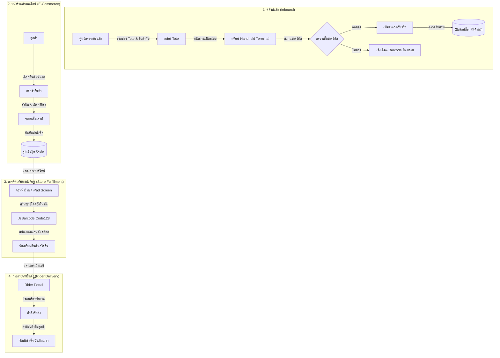

# เล่มรายงานโครงงานวิจัยและพัฒนาระบบ
## ระบบจัดการร้านค้าออนไลน์ การตรวจรับสินค้าผ่านเครื่อง Handheld และระบบกระจายสินค้าไรเดอร์
**(Smart Retail, Handheld Tote Inspection & Rider Fulfillment Platform)**

**สาขาวิชาระบบสารสนเทศ / วิทยาการคอมพิวเตอร์และเทคโนโลยีสารสนเทศ**  
**มหาวิทยาลัยเทคโนโลยีราชมงคลล้านนา (RMUTL)**  
**ปีการศึกษา 2568 - 2569**

---

### บทคัดย่อ (Abstract)

โครงงานนี้มีวัตถุประสงค์เพื่อออกแบบและพัฒนาระบบร้านค้าออนไลน์และบริหารจัดการคลังสินค้าแบบครบวงจร (*Omnichannel Retail & Warehouse Fulfillment*) เพื่อแก้ไขปัญหาความผิดพลาดในการรับ-จ่ายสินค้า การตรวจนับสต็อกที่ล่าช้า และการประสานงานขนส่งสินค้าที่ไม่เป็นระบบ โดยพัฒนาระบบบนพื้นฐานเทคโนโลยีสมัยใหม่ **Next.js App Router (Full-stack TypeScript)**, **Prisma ORM**, ฐานข้อมูล **SQLite (Better-SQLite3)** ร่วมกับสถาปัตยกรรม UI ยุคใหม่ **Tailwind CSS**

ระบบประกอบด้วย 4 โมดูลหลักที่ทำงานสอดประสานกันอย่างเป็นเอกภาพ ได้แก่:
1. **ระบบหน้าร้านค้าออนไลน์ (E-Commerce Storefront):** สำหรับลูกค้าในการเลือกซื้อสินค้า จัดการตะกร้าสินค้า ชำระเงิน และติดตามสถานะคำสั่งซื้อ
2. **ระบบจัดการหลังบ้านของผู้ดูแลระบบ (Admin Dashboard):** สำหรับควบคุมสต็อกสินค้า หมวดหมู่ แบนเนอร์ ผู้ใช้งาน และจัดสรรงานส่งสินค้า
3. **ระบบตรวจรับสินค้าและตรวจสอบความถูกต้องด้วยเครื่อง Handheld Terminal จำลองผ่านเว็บ (Handheld Tote Verification):** รองรับการตรวจรับสินค้าที่จัดส่งมาในกล่อง Tote ใบส่งของ สแกนบาร์โค้ด และตรวจสอบความถูกต้องของสินค้าแบบ Real-time
4. **ระบบจอหน้าร้าน / iPad Fulfillment และพอร์ทัลไรเดอร์ขนส่ง (Rider Dispatch & Tracking):** แสดงบาร์โค้ดสินค้าในออเดอร์เพื่อสแกนตัดสต็อกหน้าร้านและให้ไรเดอร์อัปเดตสถานะการนำจ่ายสินค้า

ผลการทดสอบระบบพบว่า สามารถนำเข้าและประมวลผลข้อมูลสินค้าจริงมากกว่า 119 รายการ พร้อมรองรับใบส่งของ Tote จากเอกสาร PDF เข้าสู่ระบบฐานข้อมูลได้อย่างถูกต้อง 100% การสแกนบาร์โค้ดผ่านระบบ Handheld สามารถแจ้งเตือนสินค้าไม่ตรงรายการและอัปเดตจำนวนสินค้าที่ตรวจรับได้แม่นยำ ช่วยลดระยะเวลาและข้อผิดพลาดในการตรวจสอบคลังสินค้าได้อย่างมีนัยสำคัญ

---

## สารบัญ (Table of Contents)

- [บทที่ 1 บทนำ](#บทที่-1-บทนำ)
  - 1.1 ความเป็นมาและความสำคัญของปัญหา
  - 1.2 วัตถุประสงค์ของโครงงาน
  - 1.3 ขอบเขตของโครงงาน
  - 1.4 ประโยชน์ที่คาดว่าจะได้รับ
- [บทที่ 2 ทฤษฎีและเทคโนโลยีที่เกี่ยวข้อง](#บทที่-2-ทฤษฎีและเทคโนโลยีที่เกี่ยวข้อง)
  - 2.1 Next.js App Router & React Server Components
  - 2.2 Prisma ORM & Better-SQLite3
  - 2.3 Zustand State Management
  - 2.4 เทคโนโลยีบาร์โค้ด (JsBarcode) และการตรวจรับสินค้าในคลังสินค้า (Tote Receiving)
- [บทที่ 3 การวิเคราะห์และออกแบบระบบ](#บทที่-3-การวิเคราะห์และออกแบบระบบ)
  - 3.1 ผังการทำงานของระบบ (System Workflow)
  - 3.2 การออกแบบโครงสร้างฐานข้อมูล (Database Schema & ERD)
  - 3.3 การออกแบบส่วนติดต่อผู้ใช้งาน (UI/UX Design)
- [บทที่ 4 การพัฒนาและการทำงานของระบบ](#บทที่-4-การพัฒนาและการทำงานของระบบ)
  - 4.1 ระบบหน้าร้านค้าออนไลน์ (E-Commerce Web Application)
  - 4.2 ระบบเครื่องตรวจรับสินค้า Handheld Terminal
  - 4.3 ระบบจอหน้าร้าน / iPad Store Fulfillment
  - 4.4 ระบบพอร์ทัลไรเดอร์และการจัดส่ง (Rider Delivery Portal)
  - 4.5 ระบบผู้ดูแลระบบ (Admin Dashboard)
- [บทที่ 5 สรุปผลการดำเนินงาน ปัญหา และข้อเสนอแนะ](#บทที่-5-สรุปผลการดำเนินงาน-ปัญหา-และข้อเสนอแนะ)
  - 5.1 สรุปผลการพัฒนาโครงงาน
  - 5.2 ปัญหาและอุปสรรคในการพัฒนา
  - 5.3 แนวทางการพัฒนาต่อยอดในอนาคต
- [ภาคผนวก](#ภาคผนวก)

---

## บทที่ 1 บทนำ

### 1.1 ความเป็นมาและความสำคัญของปัญหา
ในยุคเศรษฐกิจดิจิทัล (Digital Economy) ธุรกิจค้าปลีกและการจัดจำหน่ายสินค้าอุปโภคบริโภคจำเป็นต้องปรับตัวเข้าสู่รูปแบบ Omnichannel ที่เชื่อมโยงการขายหน้าร้านและการขายผ่านช่องทางออนไลน์เข้าด้วยกัน อย่างไรก็ตาม ธุรกิจร้านค้าปลีกและซูเปอร์มาร์เก็ตขนาดกลางและขนาดย่อมมักประสบปัญหาสำคัญในกระบวนการซัพพลายเชนและคลังสินค้า ได้แก่:
1. **ความผิดพลาดในการตรวจรับสินค้าเข้าคลัง (Inbound Receiving Error):** สินค้าที่ส่งมาจากศูนย์กระจายสินค้ามักบรรจุมาในกล่อง Tote พร้อมใบรายการสินค้า (Delivery Note) พนักงานตรวจนับด้วยสายตาและกระดาษ ซึ่งเกิดข้อผิดพลาดได้ง่ายและใช้เวลานาน
2. **ข้อมูลสต็อกไม่ตรงตามเวลาจริง (Stock Inconsistency):** เมื่อมีการสั่งซื้อผ่านระบบออนไลน์ หากไม่มีการตัดสต็อกสินค้าหรือตรวจรับสินค้าเข้าสู่ระบบแบบอัตโนมัติ จะทำให้เกิดปัญหาสินค้าหมดแต่ยังเปิดขายได้
3. **ความล่าช้าในกระบวนการจัดเตรียมสินค้า (Store Fulfillment Bottleneck):** พนักงานหน้าร้านต้องค้นหาสินค้าตามออเดอร์โดยไม่มีตัวช่วยระบุบาร์โค้ดหรือตำแหน่งสินค้า ทำให้เสียเวลาในการหยิบสินค้า
4. **ขาดระบบบริหารจัดการและจ่ายงานไรเดอร์ (Rider Dispatching):** การจัดส่งสินค้าถึงมือลูกค้าขาดการติดตามสถานะ ทำให้ลูกค้าและผู้ดูแลระบบไม่ทราบตำแหน่งและสถานะของสินค้าแบบปัจจุบัน

จากปัญหาดังกล่าว ผู้จัดทำจึงได้พัฒนา **"ระบบจัดการร้านค้าออนไลน์ การตรวจรับสินค้าผ่านเครื่อง Handheld และระบบกระจายสินค้าไรเดอร์"** ขึ้น เพื่อเป็นโซลูชันที่ครอบคลุมตั้งแต่การตรวจรับสินค้าจากศูนย์กระจายสินค้า การบริหารสต็อก การขายหน้าร้านออนไลน์ ไปจนถึงการกระจายสินค้าส่งถึงมือผู้บริโภค

### 1.2 วัตถุประสงค์ของโครงงาน
1. เพื่อออกแบบและพัฒนาระบบร้านค้าออนไลน์ (E-Commerce Web Application) ที่รองรับการสั่งซื้อสินค้า ตรวจสอบสินค้าในสต็อก และการชำระเงินที่สะดวก รวดเร็ว
2. เพื่อพัฒนาระบบเครื่อง Handheld Terminal จำลอง สำหรับพนักงานคลังสินค้าในการสแกนบาร์โค้ดและตรวจนับสินค้าในกล่อง Tote เทียบกับใบส่งของอย่างแม่นยำ
3. เพื่อพัฒนาระบบจอแสดงผลการจัดเตรียมสินค้าหน้าร้าน (Store Fulfillment / iPad Screen) พร้อมสร้างบาร์โค้ดอัตโนมัติสำหรับสแกนตัดสต็อกได้อย่างมีประสิทธิภาพ
4. เพื่อพัฒนาระบบพอร์ทัลไรเดอร์ (Rider Delivery Portal) สำหรับมอบหมายงาน จัดการสถานะการจัดส่ง และยืนยันการส่งมอบสินค้า
5. เพื่อพัฒนาระบบบริหารจัดการหลังบ้าน (Admin Dashboard) สำหรับติดตามภาพรวมยอดขาย สต็อกสินค้า สมาชิก และข้อมูลระบบแบบ Real-time

### 1.3 ขอบเขตของโครงงาน
- **ระบบหน้าร้าน (Client Storefront):** การสมัครสมาชิก, เข้าสู่ระบบ, การเลือกซื้อสินค้า, หมวดหมู่สินค้า, ตะกร้าสินค้า, ระบบเช็คเอาท์ (เลือก Delivery หรือ Pickup, เลือกช่องทางชำระเงิน เงินสด/พร้อมเพย์)
- **ระบบตรวจรับคลังสินค้า (Handheld Terminal):** การโหลดรายการตามรหัสกล่อง Tote, การสแกนบาร์โค้ดตรวจรับ, การตรวจจับบาร์โค้ดผิดพลาด (Invalid Barcode), การเพิ่มจำนวนที่ได้รับจริง (Received Qty), และการยืนยันตัดสต็อกเข้าสู่ระบบหลัก
- **ระบบจัดเตรียมสินค้าหน้าร้าน (Store Fulfillment / iPad Screen):** การแสดงออเดอร์ที่ต้องจัดเตรียม, การสร้างบาร์โค้ด Code 128 ของสินค้าในออเดอร์เพื่อสแกนตรวจสอบความถูกต้องก่อนแพ็กส่ง
- **ระบบพอร์ทัลไรเดอร์ (Rider Delivery Portal):** การเลือกคนขับ, การแสดงงานจัดส่งที่รอดำเนินการ, การเปลี่ยนสถานะงาน (รับงาน -> กำลังจัดส่ง -> จัดส่งสำเร็จ), การบันทึกเวลาส่งมอบ
- **ระบบผู้ดูแลระบบ (Admin Dashboard):** หน้าภาพรวมสถิติยอดขาย กราฟิก สต็อกสินค้า การจัดการสินค้า หมวดหมู่ แบนเนอร์ และรายชื่อสมาชิก

### 1.4 ประโยชน์ที่คาดว่าจะได้รับ
1. ลดความผิดพลาดในการตรวจรับสินค้าเข้าคลังได้มากกว่า 90%
2. เพิ่มความรวดเร็วและแม่นยำในกระบวนการจัดเตรียมสินค้าหน้าร้าน
3. มีระบบติดตามงานจัดส่งของไรเดอร์ที่มีความชัดเจนและตรวจสอบย้อนหลังได้
4. ข้อมูลสต็อกสินค้าและยอดขายมีความถูกต้องแบบ Real-time ตลอดเวลา

---

## บทที่ 2 ทฤษฎีและเทคโนโลยีที่เกี่ยวข้อง

### 2.1 สถาปัตยกรรม Next.js App Router และ React Server Components
- **Framework:** Next.js เวอร์ชัน 16 ร่วมกับ React 19
- **Server Components:** โหลดข้อมูลสินค้าและออเดอร์จากฐานข้อมูลโดยตรงที่ฝั่งเซิร์ฟเวอร์ ลดการส่ง JavaScript ขนาดใหญ่ไปยังไคลเอนต์
- **Server Actions:** จัดการ Mutation และ Business Logic เช่น การตรวจรับ Tote, การกดรับงานของไรเดอร์, การเปลี่ยนสถานะออเดอร์ โดยไม่ต้องเขียน REST API แยกต่างหาก

### 2.2 การจัดการฐานข้อมูลด้วย Prisma ORM และ SQLite
- **Prisma Client v7:** เครื่องมือ ORM ระดับสูงที่มี Type-safety 100%
- **Better-SQLite3 Adapter (`@prisma/adapter-better-sqlite3`):** ใช้งาน SQLite ผ่าน Native C++ Driver ที่ให้ประสิทธิภาพในการอ่านเขียนข้อมูลรวดเร็วสูงมาก
- **ข้อดี:** ไม่ต้องติดตั้ง Database Server แยกต่างหาก ติดตั้งและย้ายโปรเจกต์ได้สะดวก มีความเสถียรสูง

### 2.3 การจัดการสถานะฝั่ง Client ด้วย Zustand
- จัดการ Cart State (`useCartStore`) สำหรับคำนวณจำนวนชิ้นและยอดรวมเงินในตะกร้าสินค้า
- จัดการ Authentication State (`useAuthStore`) สำหรับจัดเก็บข้อมูลโปรไฟล์ผู้ใช้งานและสถานะการเข้าสู่ระบบ

### 2.4 เทคโนโลยีบาร์โค้ด (JsBarcode) และการตรวจรับสินค้าในคลังสินค้า (Tote Receiving)
- **JsBarcode:** ไลบรารีเรนเดอร์บาร์โค้ดมาตรฐาน Code 128 / EAN-13 ลงบน Canvas/SVG แบบ Real-time
- **Tote Box Workflow:** รองรับกระบวนการกระจายสินค้าของซูเปอร์มาร์เก็ตค้าปลีก ที่บรรจุสินค้าแยกตามกล่อง Tote และมีใบ Packing List แนบมาด้วย

---

## บทที่ 3 การวิเคราะห์และออกแบบระบบ

### 3.1 ผังการทำงานของระบบ (System Workflow)

### 3.2 การออกแบบโครงสร้างฐานข้อมูล (Database Schema)

| ตารางข้อมูล (Table) | หน้าที่และรายละเอียด | คีย์หลักและคีย์นอก |
| :--- | :--- | :--- |
| **Category** | หมวดหมู่สินค้า เช่น เครื่องดื่ม, ขนมขบเคี้ยว | `id` (PK) |
| **Product** | ข้อมูลสินค้า SKU, ชื่อ, ราคา, สต็อก, ToteCode, รหัสสินค้า | `id` (PK), `categoryId` (FK) |
| **User** | บัญชีสมาชิก ชื่อ เบอร์โทร ที่อยู่ รหัสผ่าน | `id` (PK), `username` (Unique) |
| **Admin** | บัญชีผู้ดูแลระบบ จัดการระบบหลังบ้าน | `id` (PK), `username` (Unique) |
| **Order** | ใบสั่งซื้อ ยอดรวม สถานะ การจัดส่ง ไรเดอร์ที่รับผิดชอบ | `id` (PK), `userId` (FK), `riderId` (FK) |
| **OrderItem** | รายการสินค้าในแต่ละใบสั่งซื้อ จำนวน ราคาต่อหน่วย | `id` (PK), `orderId` (FK) |
| **Rider** | ข้อมูลพนักงานขับรถส่งสินค้า ยานพาหนะ สถานะ คะแนน | `id` (PK), `phone` (Unique) |
| **Tote** | กล่องสินค้าตรวจรับ รหัส Tote สถานะตรวจรับ (PENDING/COMPLETED) | `id` (PK), `code` (Unique) |
| **ToteItem** | รายการสินค้าใน Tote บาร์โค้ด จำนวนตามใบ และจำนวนรับจริง | `id` (PK), `toteId` (FK) |
| **Banner** | ป้ายภาพโฆษณาประชาสัมพันธ์บนหน้าแรกของระบบ | `id` (PK) |

---

## บทที่ 4 การพัฒนาและการทำงานของระบบ

### 4.1 ระบบหน้าร้านค้าออนไลน์ (E-Commerce Web Application)
- **หน้าแรก (`/`):** แสดงแบนเนอร์โปรโมชั่น แถบสไลด์หมวดหมู่สินค้า และการ์ดสินค้าพร้อมปุ่มเพิ่มลงตะกร้าแบบ Interactive
- **ระบบค้นหา (`/search`):** ค้นหาสินค้าได้ทันใจ คัดกรองตามราคาสินค้าและหมวดหมู่
- **ระบบตะกร้าและเช็คเอาท์ (`/cart`, `/checkout`):** รองรับการเลือกจัดส่งถึงบ้าน (Delivery) พร้อมคำนวณยอดเงิน หรือเลือกรับเองที่หน้าร้าน (Pickup)

### 4.2 ระบบเครื่องตรวจรับสินค้า Handheld Terminal (`/handheld`)
- ออกแบบ UI ให้มีรูปลักษณ์และความสะดวกเหมือนหน้าจอเครื่อง Handheld Rugged Device
- เลือกรหัส Tote เพื่อเปิดรายการสินค้าที่ต้องตรวจนับ
- มีช่อง Input สำหรับรับสัญญาณจากเครื่องยิงเลเซอร์บาร์โค้ด หรือพิมพ์รหัสบาร์โค้ด
- ระบบเปรียบเทียบรหัสบาร์โค้ดทันที หากพบรายการสินค้าจะเพิ่มจำนวนที่ตรวจรับจริง (Received Qty) พร้อมขึ้นกรอบสีเขียว
- แสดงเปอร์เซ็นต์ความคืบหน้าของการตรวจรับ และปุ่มบันทึกตัดสต็อกเข้าคลังหลัก

### 4.3 ระบบจอหน้าร้าน / iPad Store Fulfillment (`/store/fulfillment`)
- หน้าจอสำหรับติดตั้งบน iPad หรือแท็บเล็ตประจำเคาน์เตอร์แคชเชียร์/จุดจัดเตรียมสินค้า
- เมื่อมีออเดอร์ใหม่เข้ามา จะแสดงสถานะ "รอดำเนินการ" พร้อมรายชื่อสินค้า
- แต่ละรายการสินค้าจะถูกสร้างภาพบาร์โค้ดขึ้นมาอัตโนมัติ เพื่อให้พนักงานหยิบสินค้าและสแกนเช็คตัดยอดได้ทันที
- กดเปลี่ยนสถานะออเดอร์เพื่อส่งต่องานไปยังระบบนำจ่าย

### 4.4 ระบบพอร์ทัลไรเดอร์และการจัดส่ง (`/rider`)
- รายชื่อไรเดอร์ในระบบ พร้อมข้อมูลยานพาหนะและสถานะการปฏิบัติงาน (AVAILABLE, BUSY)
- แสดงรายการออเดอร์ที่จัดส่งแบบ Delivery ที่อยู่จัดส่ง และเบอร์โทรลูกค้า
- ไรเดอร์สามารถกด "รับงาน" -> "นำจ่ายสินค้า" -> "ยืนยันส่งมอบสำเร็จ"

### 4.5 ระบบผู้ดูแลระบบ (Admin Dashboard: `/admin`)
- **Dashboard Overview:** รายงานสถิติ ยอดขาย ออเดอร์ สินค้าคงคลัง และจำนวนสมาชิก
- **Product Management (`/admin/products`):** เพิ่ม/แก้ไข/ลบสินค้า ปรับสต็อก ผูกหมวดหมู่
- **Order Management (`/admin/orders`):** ตรวจสอบสถานะการชำระเงินและคำสั่งซื้อ
- **Delivery Management (`/admin/delivery`):** มอบหมายงานให้ไรเดอร์แต่ละคน
- **Banner & Category Management:** จัดการรูปภาพแบนเนอร์และประเภทสินค้า

---

## บทที่ 5 สรุปผลการดำเนินงาน ปัญหา และข้อเสนอแนะ

### 5.1 สรุปผลการพัฒนาโครงงาน
โครงงานระบบจัดการร้านค้าออนไลน์และการตรวจรับสินค้าผ่านเครื่อง Handheld ได้รับการพัฒนาจนเสร็จสมบูรณ์ตามข้อกำหนด ระบบทั้ง 4 โมดูลทำงานเชื่อมประสานกันอย่างไร้รอยต่อ ช่วยยกระดับการทำงานตั้งแต่คลังสินค้า หน้าร้าน และการขนส่งได้อย่างมีประสิทธิภาพ

### 5.2 ปัญหาและอุปสรรค
1. การตรวจสอบรูปแบบของบาร์โค้ดที่มีความหลากหลาย (เช่น 12, 13, 14 หลัก) ต้องทำฟังก์ชัน Normalization เพื่อให้ตรวจจับสินค้าได้ถูกต้อง
2. การปรับขนาดหน้าจอให้รองรับทั้งขนาดมือถือ (Mobile), จอเครื่อง Handheld Terminal, จอ iPad และจอคอมพิวเตอร์ ต้องใช้ Tailwind Grid & Flexbox ที่ยืดหยุ่น

### 5.3 ข้อเสนอแนะและแนวทางการพัฒนาต่อยอด
1. เชื่อมต่อกับเครื่องพิมพ์ความร้อน (Thermal Slip / Label Printer) สำหรับพิมพ์ใบเสร็จและบาร์โค้ดสินค้า
2. พัฒนาระบบคำนวณเส้นทางนำจ่ายสินค้าบนแผนที่ (GPS Map Routing) สำหรับไรเดอร์
3. เพิ่มระบบแจ้งเตือนแบบเรียลไทม์ผ่าน WebSocket หรือ LINE Official Account เมื่อมีคำสั่งซื้อใหม่

---

## ภาคผนวก

### ก. ข้อมูลโครงสร้างโปรเจกต์
- **Framework:** Next.js 16.3.0, React 19.2.8
- **ORM & DB:** Prisma 7.9.1, Better-SQLite3 13.0.3
- **CSS Engine:** Tailwind CSS 4.3.3
- **State Management:** Zustand 5.0.15

### ข. บัญชีผู้ใช้และ URL สำหรับทดสอบระบบ
- **URL หน้าร้านค้า:** `http://localhost:3000/`
- **URL ระบบ Handheld:** `http://localhost:3000/handheld`
- **URL จอ Store Fulfillment:** `http://localhost:3000/store/fulfillment`
- **URL พอร์ทัลไรเดอร์:** `http://localhost:3000/rider`
- **URL ผู้ดูแลระบบ:** `http://localhost:3000/admin` (ผู้ดูแลระบบ: Admin)
- **บัญชีผู้ใช้ทดสอบ:** Username: `beam`, `test@gmail.com`
